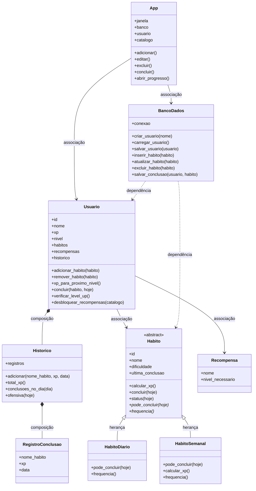

# Hábitos Gamificados

Aplicativo desktop em Python (Tkinter) para gerenciar hábitos do dia a dia com gamificação:
cada hábito concluído gera **XP**, e o usuário **sobe de nível** e desbloqueia **recompensas**.

Projeto da disciplina de **Orientação a Objetos**, Engenharia de Software.

## Como rodar

Precisa só do Python 3 instalado. Tkinter e SQLite já vêm com ele.

```bash
python main.py
```

Na primeira vez o programa pergunta o seu nome. Os dados ficam salvos no arquivo `habitos.db`.

## Como rodar os testes

```bash
python -m unittest -v
```

## Estrutura de pastas

```
habitos_gamificado/
├── main.py              # ponto de entrada: abre a janela
├── interface.py         # classe App (telas em Tkinter)
├── estilo.py            # cores, fontes e componentes visuais (botões, cartões)
├── banco.py             # classe BancoDados (SQLite)
├── modelos/
│   ├── habito.py        # Habito (abstrata), HabitoDiario, HabitoSemanal
│   ├── usuario.py       # Usuario
│   ├── historico.py     # Historico, RegistroConclusao
│   └── recompensa.py    # Recompensa
└── testes/
    ├── test_habito.py
    ├── test_usuario.py
    └── test_banco.py
```

## Casos de uso

| Caso de uso | Onde está |
|---|---|
| UC01 Gerenciar Hábitos (incluir, alterar, excluir) | `App.adicionar`, `App.editar`, `App.excluir` |
| UC02 Registrar Conclusão Diária | `App.concluir` → `Usuario.concluir` |
| UC03 Visualizar Progresso | `App.abrir_progresso` (nível, barra de XP, ofensiva, gráfico, recompensas) |

## Regras de negócio

| Regra | Onde está | Teste |
|---|---|---|
| RN01: uma tarefa só gera XP uma vez por ciclo | `HabitoDiario.pode_concluir` e `HabitoSemanal.pode_concluir` | `test_rn01_nao_ganha_xp_duas_vezes_no_mesmo_ciclo` |
| RN02: ao atingir o limite de XP, sobe de nível | `Usuario.verificar_level_up` | `test_rn02_level_up` |

Cálculo do XP: `dificuldade × 10` (fácil = 10, médio = 20, difícil = 30). O hábito semanal vale o dobro.
Para subir do nível N para o N+1 são necessários `N × 100` XP.

## Relações de Orientação a Objetos

| Relação | Classes | Explicação |
|---|---|---|
| **Herança** | `HabitoDiario` e `HabitoSemanal` herdam de `Habito` | `Habito` é abstrata (`ABC`) e guarda o que é comum: nome, dificuldade e cálculo de XP. |
| **Polimorfismo** | `pode_concluir()` e `calcular_xp()` | O `Usuario` chama `habito.pode_concluir()` sem saber o tipo, e cada classe responde de um jeito: o diário libera por dia, o semanal a cada 7 dias e vale o dobro de XP. |
| **Composição** | `Usuario` ◆ `Historico` ◆ `RegistroConclusao` | O `Historico` é criado dentro do `__init__` do `Usuario` e só existe junto com ele. O mesmo vale para os registros dentro do histórico. |
| **Associação** | `Usuario` → `Habito`, `Usuario` → `Recompensa`, `App` → `BancoDados` | Os objetos são criados fora e o usuário (ou a App) só guarda uma referência a eles. |
| **Dependência** | `BancoDados` ⇢ `Usuario`, `BancoDados` ⇢ `Habito` | O banco recebe usuário e hábito como parâmetro nos métodos (`salvar_usuario`, `inserir_habito`...), mas não guarda eles como atributo. |

## Diagrama de classes (UML)

O GitHub desenha esse diagrama automaticamente. Para gerar uma imagem, cole o código em https://mermaid.live.



Legenda: `<|--` herança, `*--` composição, `-->` associação, `..>` dependência.
